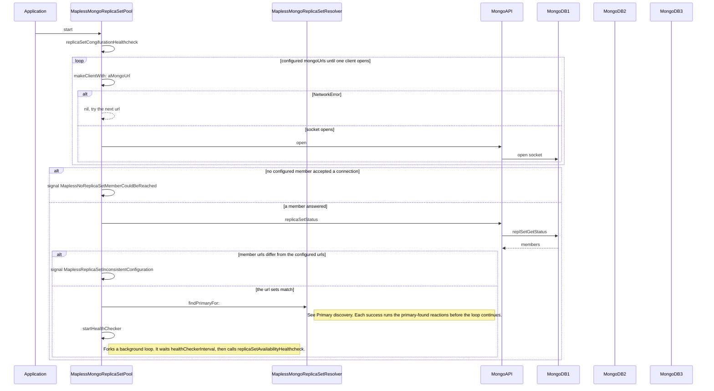
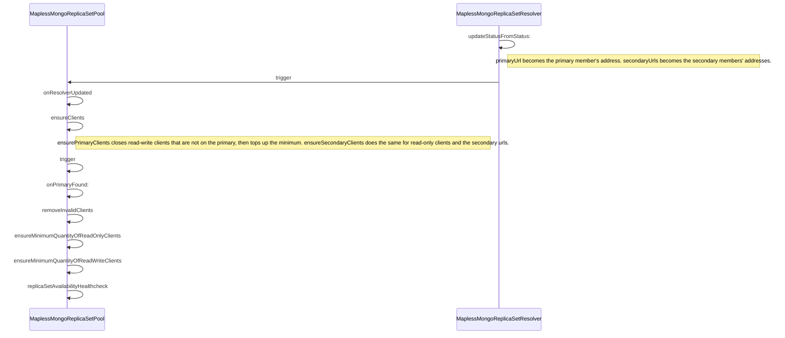
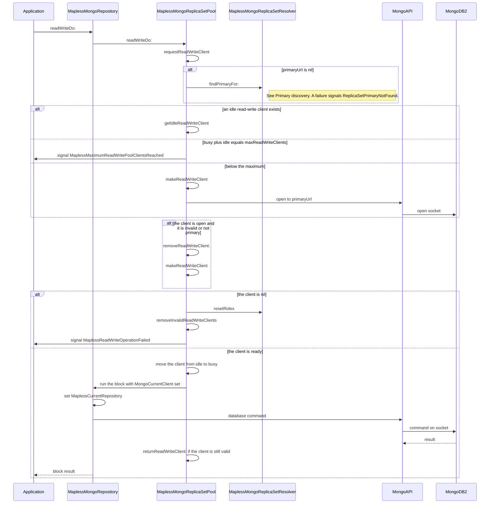
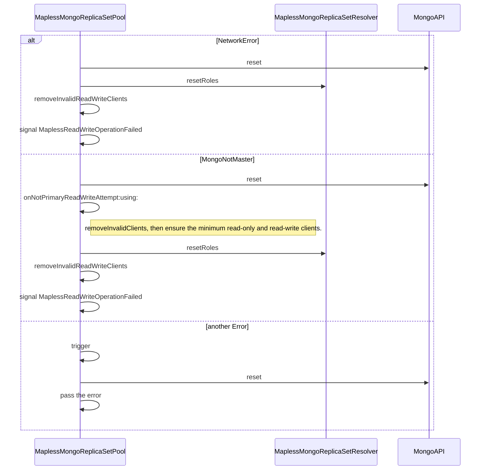
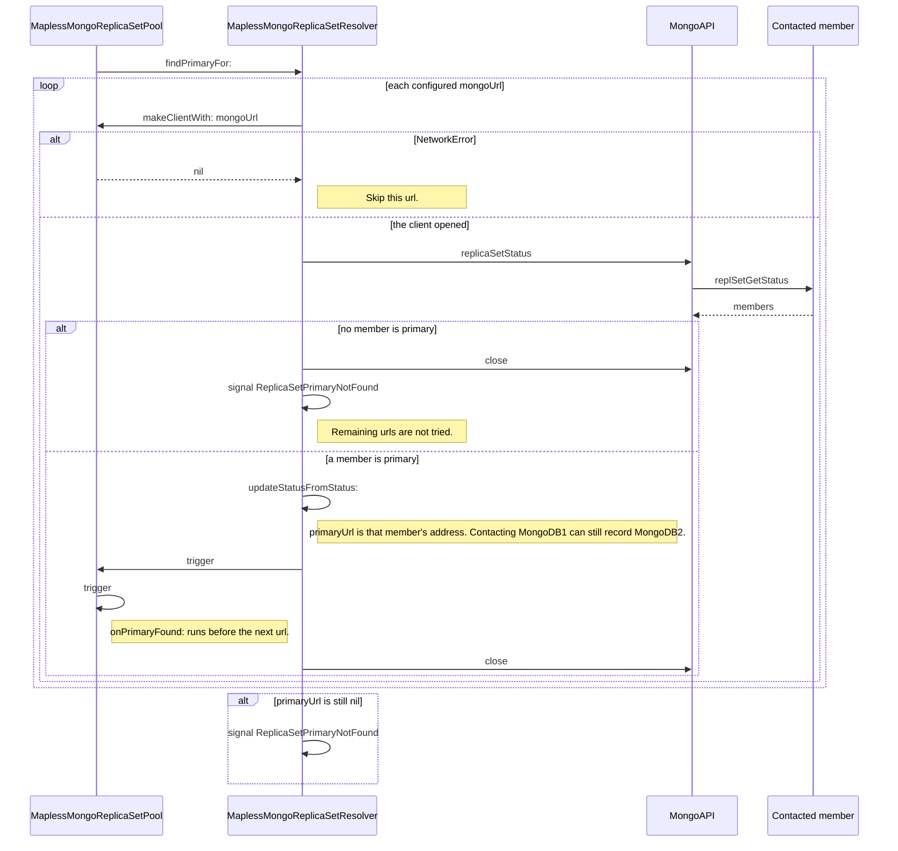

# MongoDB replica set

Sequence diagrams for a Mapless MongoDB replica set. The repository's accessor is a `MaplessMongoReplicaSetPool`. The pool asks a `MaplessMongoReplicaSetResolver` which member is primary. In these examples MongoDB2 is the primary.

`MaplessRepository>>startUp:` sends `start:` to the accessor. `MaplessMongoReplicaSetPool` implements `start`, so startup below is `start`.

## Replica set starts

Pool construction has already registered `#primaryFound` to `onPrimaryFound:` and `#notPrimaryReadWriteAttempt` to `onNotPrimaryReadWriteAttempt:using:`. The resolver's `#rolesUpdated` is registered to `onResolverUpdated`.

The configuration check leaves its status client open.

## When a primary is recorded

`findPrimaryFor:` does this once for every contacted member whose status names a primary. `updateStatusFromStatus:` runs first, then `#primaryFound`.

`replicaSetAvailabilityHealthcheck` calls `ensureTopology`, checks that the primary answers a query, checks each secondary, then calls `ensureClients` again. `removeInvalidClients` closes idle read-only clients connected to the primary and idle read-write clients connected anywhere else.

## Write

`makeClientWith:` returns nil on `NetworkError`, so a failed open becomes the nil branch above. A client that is already nil is not replaced a second time. Only a live client that fails `isValid` or `isPrimary` is discarded and opened once more.

If the block raises, the pool does not retry the command.

## Primary discovery

Discovery clients are closed. Later reads and writes open their own clients to the recorded primary and secondary urls.
